# AI_Project — Sistema de recomendación

## 1. Introducción

El proyecto consiste en desarrollar un sistema de recomendación de películas utilizando Python y GitHub Copilot como herramienta de apoyo a la programación.

## 2. Objetivo

Explorar las capacidades de la inteligencia artificial generativa para apoyar la creación de código y desarrollar un programa que recomiende películas según los géneros favoritos del usuario.

## 3. Herramientas utilizadas

- GitHub.
- GitHub Copilot.
- Visual Studio Code.
- Python.
- Git.

## 4. Desarrollo de la actividad

### 4.1 Cuenta de GitHub

Se ingresó a https://github.com con una cuenta de GitHub ya existente.

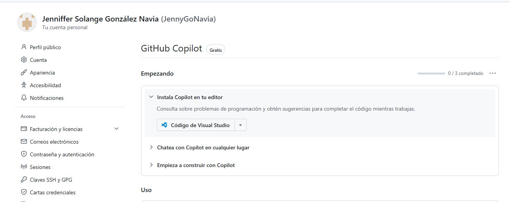

### 4.2 Plan gratuito de GitHub Copilot

Se seleccionó el plan gratuito en la sección de precios y se activó GitHub Copilot Free, verificando su estado en Visual Studio Code.

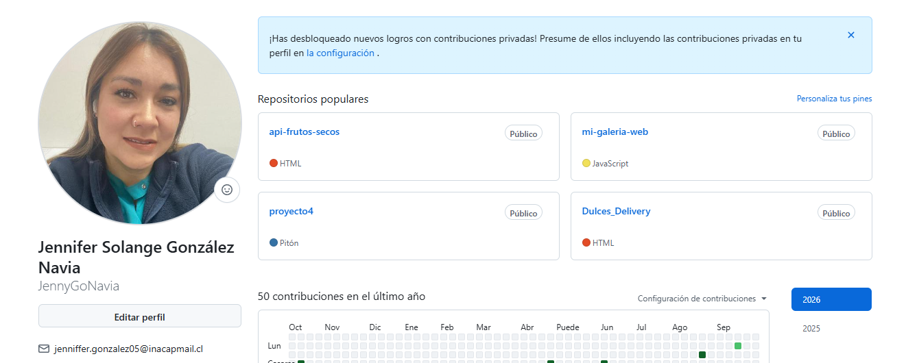

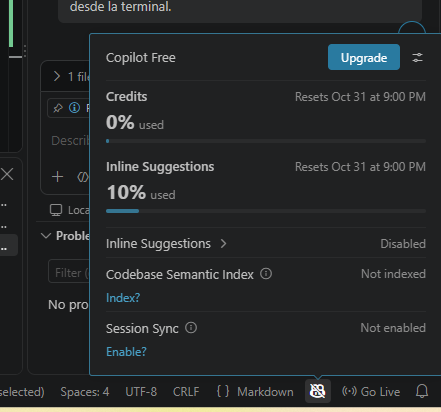

### 4.3 Creación del repositorio

Se creó un repositorio llamado AI_Project, de visibilidad pública, con un archivo README y un archivo .gitignore para Python.

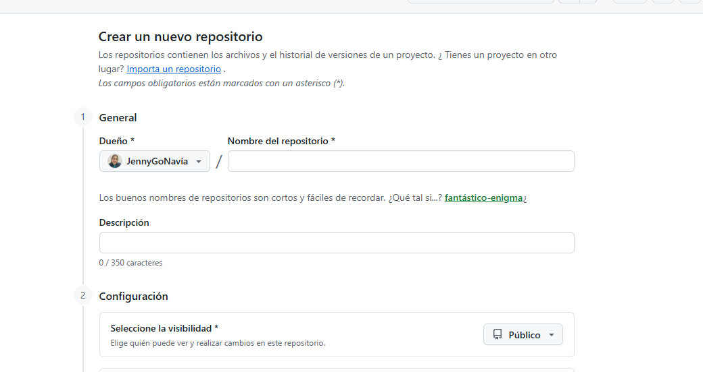

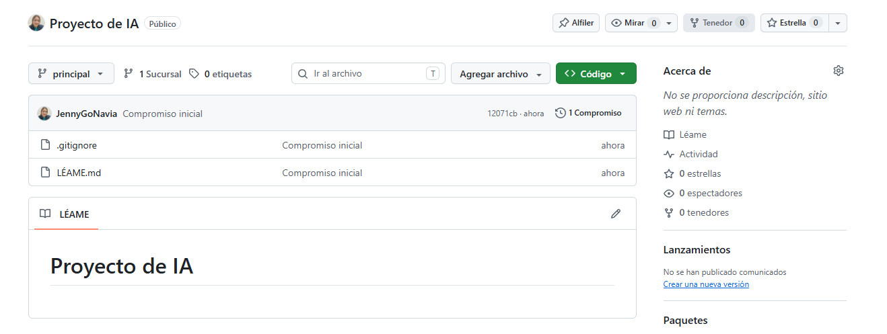

### 4.4 Clonación del repositorio

Se instaló la extensión de GitHub Copilot en Visual Studio Code, se inició sesión y se clonó el repositorio con el comando `git clone` desde la terminal integrada.

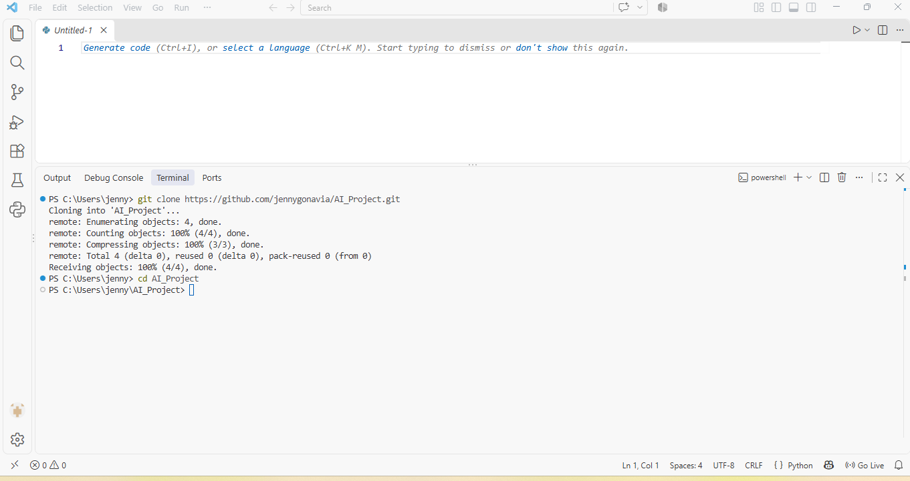

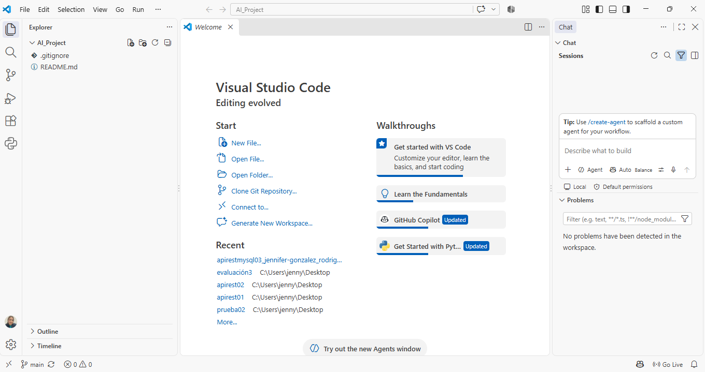

### 4.5 Generación del código con Copilot

Se creó el archivo recommendation_system.py y se utilizó GitHub Copilot Chat con un prompt que solicitaba un sistema de recomendación de películas por géneros favoritos, usando funciones, listas y diccionarios, sin librerías externas.

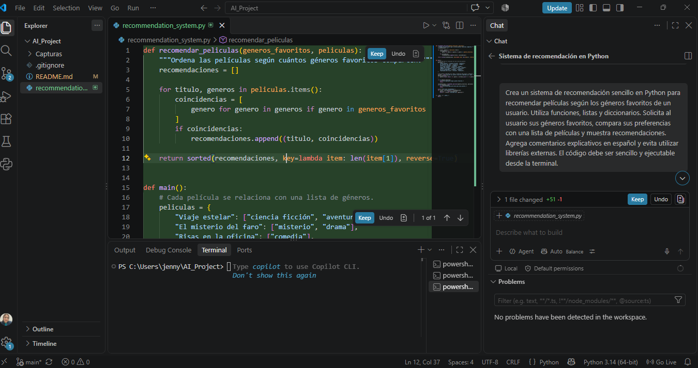

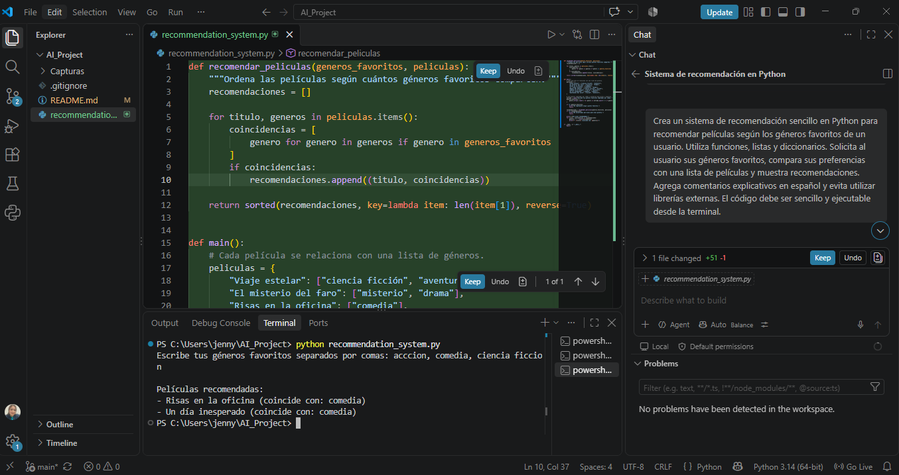

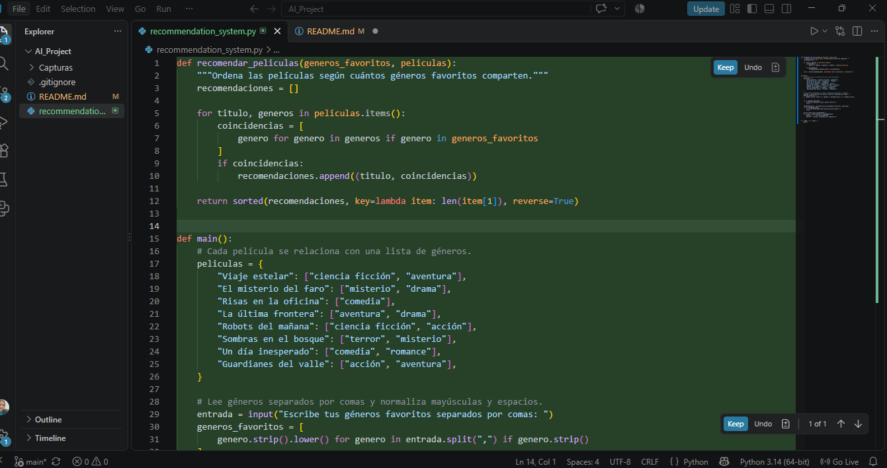

### 4.6 Ejecución y pruebas

Se ejecutó el programa desde la terminal de Visual Studio Code. Como prueba, se ingresaron los géneros acción, comedia y ciencia ficción. El sistema mostró las películas Risas en la oficina y Un día inesperado, ambas asociadas al género comedia.

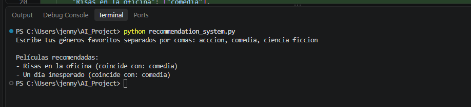

### 4.7 Documentación

Se documentó el proceso en el archivo README.md, con descripciones de cada paso y capturas de pantalla.

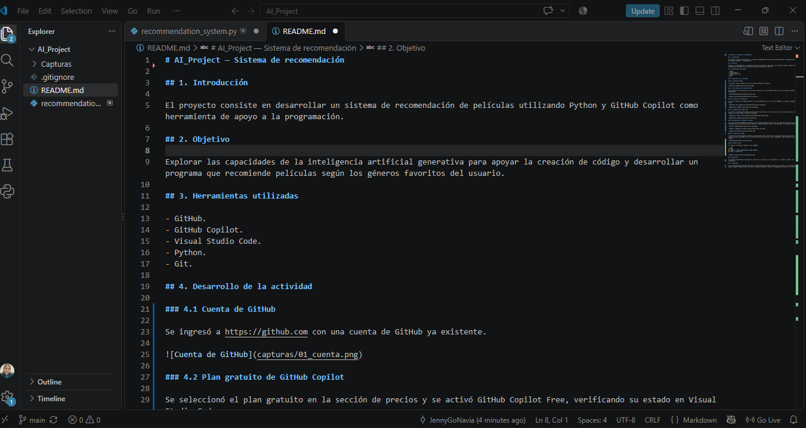

### 4.8 Commit y push

Los cambios se subieron a GitHub con los comandos:

```bash
git add .
git commit -m "Add recommendation system example"
git push -u origin main
```

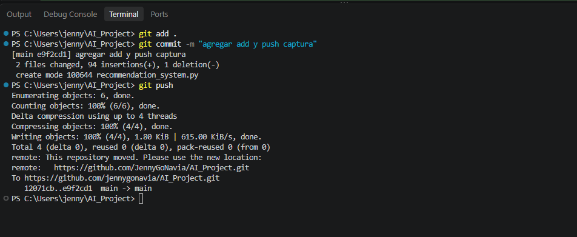

## 5. Evidencias

Las capturas de pantalla de cada paso se incluyen en la sección 4 y se encuentran en la carpeta `Capturas` del repositorio.

## 6. Conclusión

La actividad permitió aplicar GitHub Copilot como herramienta de apoyo al desarrollo de software. Se comprobó que puede ayudar a generar código inicial, pero que es necesario ejecutar y revisar el programa para verificar sus resultados.